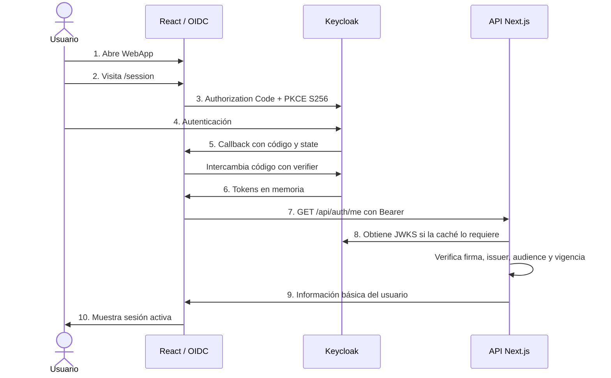

# Design

## Context

Ver [proposal.md](proposal.md) para la motivación. La inspección encontró aplicaciones independientes ya funcionales, con React/Vite/Material UI/Zustand/React Router en frontend y Next.js App Router como API REST en backend. No se presupone una aplicación nueva.

| Base observada | Consecuencia del diseño |
| --- | --- |
| `frontend/src/app/main.tsx` compone HTTP, caso de uso de health y store; `app.tsx` registra `/` y fallback. | Extender esa composición con autenticación sin trasladar construcción de adaptadores a componentes. |
| `frontend/src/modules/authentication` tiene capas reservadas; el cliente HTTP actual solo hace GET público y convierte todos los errores HTTP a una categoría. | Añadir puertos y casos de uso del módulo, transporte protegido y clasificación específica de 401. Preservar cancelación/timeout. |
| `backend/src/modules/identity/application/identity-verifier.ts` declara `IdentityVerifier.verify` y actor con `subject`/`permissions`; no hay implementación registrada. | Evolucionar el contrato y conectar un adaptador real desde bootstrap. No crear un segundo sistema de identidad. |
| Configuración Keycloak opcional issuer/audience, validación runtime antes de endpoints y errores comunes 503/500. | Mantener el arranque público sin identidad; exigir configuración al atender rutas privadas. |
| OpenAPI está en `backend/openapi/openapi.json`; Swagger usa assets locales. | Extender la fuente única y su prueba HTTP, sin documento alternativo. |
| Compose contiene frontend/backend/MongoDB; `/api` y assets Swagger pasan por proxy; existen controles de arquitectura y pruebas Vitest/Playwright. | Añadir Keycloak y pruebas específicas sobre esas herramientas, sin reorganización general. |

Se revisaron completas las specs principales `backend-runtime`, `frontend-shell`, `local-development` y la propuesta base `initial-invoices-app`, especialmente `identity-access` y `project-foundation`. Hay dos conflictos explícitos que resuelven las deltas: foundations prohíbe activar Keycloak y limita la aprobación a su incremento. La autenticación requiere reemplazar esas restricciones, conservando la salud pública. El título histórico «Integración de identidad preparada e inactiva» se conserva para identificar exactamente el requisito modificado; su contenido nuevo establece la activación.

`identity-access` todavía no existe en specs principales: se añade con el mismo nombre de la propuesta base, cubriendo autenticación y preparación de roles, sin afirmar que se completó su autorización organizacional. P6 de la propuesta base queda concretada aquí; P1 solo recibe nombres de roles, no una matriz de permisos organizacionales. No se modifican ni completan tareas de aquella propuesta. El Purpose actual de `backend-runtime` también menciona ausencia de autenticación: se documenta su actualización para la futura sincronización aprobada, sin editar hoy las specs principales.

## Goals / Non-Goals

**Goals:** establecer identidad verificable desde navegador hasta API; aislar OIDC/JWT en adaptadores; demostrar sustitución de puertos y dirección de dependencias; mantener los comandos de calidad y builds independientes de servicios externos.

**Non-Goals:** BFF, sesiones propias con cookies, introspección por solicitud, perfiles o contraseñas persistidos en MongoDB, gestión de usuarios desde la aplicación, reglas de organizaciones, jerarquías administrativas o despliegue. El único endpoint nuevo es `GET /api/auth/me`; `/session` es una pantalla de verificación, no un dashboard de negocio.

## Decisions

### 1. Límites de capas y contratos

Identity & Access es dueño de la identidad externa verificada. Organizations seguirá siendo dueño de asociaciones y contexto cuando exista ese incremento. No se añaden agregados, repositorios, modelos Mongoose, eventos ni bus sin una regla que los necesite.

| Capa | Frontend | Backend |
| --- | --- | --- |
| Domain | Tipos puros mínimos de identidad/roles cuando sean necesarios; sin duplicar autorización backend. | Roles conocidos y actor puro; sin JWT, claims Keycloak ni SDK. |
| Application | Puertos específicos de sesión OIDC, obtención temporal de Access Token y consulta de usuario; casos de uso inicializar, iniciar/cerrar sesión y leer sesión actual. | Evolucionar `IdentityVerifier`, caso de uso de usuario actual y política reutilizable de roles; errores tipados de autenticación/autorización. |
| Infrastructure | Adaptador `keycloak-js`, adaptador HTTP de `/auth/me`, transporte autenticado y configuración pública. | Adaptador Keycloak/JWT con `jose`, configuración y traducción de claims. |
| Presentation | Store Zustand no persistido, guard de rutas, callback y estados Material UI; invoca casos de uso. | Extracción Bearer y respuestas HTTP en controladores; wrapper reutilizable, sin instanciar verificador. |
| Composition | `frontend/src/app`: instancia única de adaptador, casos de uso y stores. | `backend/src/bootstrap`: verificador compartido por proceso y conexión de handlers; entrada en `src/app/api/auth/me/route.ts`. |

`AuthenticatedActor` conservará `subject` y podrá ampliar `roles`, `username`, `name`, `email`. `permissions` se mantiene como arreglo vacío hasta definir permisos reales; no se equiparan roles y permisos. No hay consumidores funcionales existentes que dependan de permisos. El caso de uso recibe un actor verificado, no un token decodificado libremente; el controlador mapea `subject` a `user.id`.

SRP separa flujo OIDC, transporte, verificación y UI; OCP permite otros proveedores mediante puertos; LSP exige resultados/errores iguales en adaptadores reales y dobles; ISP separa consulta de usuario y ciclo de sesión; DIP deja SDK y HTTP fuera de Application. Extender las reglas existentes de dependency-cruiser para detectar también `keycloak-js` y `jose` en capas internas, sin debilitar ciclos, alias o separación entre aplicaciones. Alternativa descartada: usar el SDK directamente desde componentes o handlers, porque elimina sustitución y dispersa decisiones de seguridad.

### 2. Realm, cliente y roles de desarrollo

Valores propuestos revisables con esta propuesta: realm `invoices`, cliente público OIDC `invoices-web`, audiencia de recurso `invoices-api`. Activar Standard Flow y exigir PKCE S256; desactivar Client Authentication, Implicit Flow, Direct Access Grants y Service Accounts. Solicitar `openid profile email`; no solicitar `offline_access`.

Configurar Redirect URI exacta `http://localhost:5173/auth/callback`, post-logout URI exacta `http://localhost:5173/` y Web Origin `http://localhost:5173`. Otros puertos o el host `127.0.0.1` requieren entradas explícitas, no `*`. La configuración documentada debe derivar los destinos del origen público seleccionado.

Crear realm roles no compuestos `APP_ADMIN`, `COMPANY_ADMIN`, `THIRD_PARTY_ADMIN`, `DRIVER`; ninguno se asigna por defecto. Mapear solo roles conocidos desde `realm_access.roles` después de validar el token; ignorar roles técnicos como `offline_access`. Un actor sin esos roles sigue pudiendo consultar su identidad. La política de roles acepta una lista requerida y deniega si falta cualquiera; lista vacía solo exige autenticación. No existe jerarquía ni privilegio global implícito de `APP_ADMIN`.

Asociar al cliente web un client scope por defecto con mapper Audience: **Included Custom Audience** `invoices-api`, agregado al Access Token, no al ID Token. No hace falta crear un cliente confidencial ni un secreto de API para verificar JWT. Se elige mapper explícito porque la audiencia no debe depender de asignar roles a un usuario. La documentación de Keycloak distingue la audiencia del Access Token de la del cliente que recibe el ID Token. [Guía de administración: audiencia](https://www.keycloak.org/docs/latest/server_admin/index.html#_audience).

Proponer Access Token de 5 minutos, SSO idle de 30 minutos y máximo de 8 horas para desarrollo. Keycloak administra passwords y sesión SSO. Un archivo de importación reproducible contiene configuración, roles y mappers, nunca usuarios, passwords, secretos o claves privadas. El usuario local se crea después en la consola; pruebas utilizan un realm separado y credenciales efímeras suministradas fuera del repositorio.

### 3. Flujo frontend y estado

Elegir `keycloak-js` como adaptador OIDC y encapsular toda su API. Configurar `flow: standard`, `pkceMethod: S256`, nonce habilitado, logs desactivados y `checkLoginIframe: false`. Inicializar una sola vez antes del router; no usar `login-required` global. La biblioteca soporta cliente público, PKCE y renovación, con tokens en memoria. [Adaptador oficial](https://www.keycloak.org/securing-apps/javascript-adapter).

Inicio público `/` conserva health y añade acción de login. Callback público `/auth/callback` procesa correlación y código antes del render privado. `/session` usa guard: durante inicialización muestra carga; anónimo con configuración válida inicia un intento de login; un error previo exige acción explícita. El destino posterior se limita a rutas relativas admitidas del mismo origen, inicialmente `/session`; descartar esquemas, `//`, destinos externos y callbacks recursivos.

No depender de silent SSO ni cookies de terceros. Tras recarga, los tokens se pierden: acceder a `/session` realiza una nueva redirección de primer nivel; una sesión SSO vigente puede completar el flujo sin volver a solicitar contraseña. La página pública no fuerza login para averiguar si existe SSO.

Zustand contiene estado `initializing | anonymous | authenticating | authenticated | refreshing | signingOut | error`, perfil público, error normalizado y estado separado de consulta `/me`. No contiene tokens, instancia SDK, persist middleware ni devtools que serialicen credenciales. El estado `authenticated` acredita el flujo OIDC; la etiqueta «sesión activa» de `/session` requiere además un `/me` válido.

Los tokens viven únicamente en memoria privada del adaptador. Se permite el almacenamiento transitorio que necesite la biblioteca para state/nonce/verifier durante una redirección, sin tokens y con limpieza al completar o expirar; auditar la versión seleccionada para asegurar esa distinción. El código OIDC se consume una vez y se limpia de la URL. Alternativas descartadas: tokens en localStorage para sobrevivir a recargas y login propio con passwords; ambas contradicen el alcance.

### 4. Renovación, transporte y logout

Una promesa compartida coordina renovación cuando quedan menos de 30 segundos, desde el evento de expiración o antes de cada solicitud protegida. Limitar esperas OIDC a 10 segundos y HTTP a los 5 segundos ya usados. Si hay timeout, invalidar la generación de sesión para que una respuesta tardía no la reactive; una nueva inicialización usa una instancia limpia del adaptador. Fallo de refresh limpia memoria y perfil y exige login explícito.

El cliente protegido resuelve URLs contra la base API validada, rechaza destinos fuera de ella y usa `redirect: error`; obtiene el token justo antes de enviar, mantiene AbortSignal y no modifica el cliente público de health. Desarrollo usa `/api` por proxy del mismo origen; no se añade configuración CORS backend abierta. Un 401 invalida sesión sin reintento automático; errores de red/5xx permiten reintentar `/me` sin iniciar bucles OIDC. No se envía el ID Token como Bearer.

Logout obtiene primero los parámetros requeridos por Keycloak (incluido ID Token hint si corresponde), prepara la URL de cierre y elimina inmediatamente tokens, perfil, temporizadores y solicitudes pendientes antes de navegar. Mantener únicamente un marcador transitorio sin credenciales si hace falta para indicar cierre remoto no confirmado al regresar. Si falla la navegación o el usuario regresa de un fallo del proveedor, la UI conserva el cierre local y ofrece reintentar cierre remoto. El ID Token hint protocolario no se registra ni se persiste. No se promete confirmar un cierre remoto sin respuesta del proveedor.

### 5. Verificación JWT y JWKS en backend

Usar Route Handlers con runtime Node.js y un wrapper de autenticación explícito conectado en bootstrap. La verificación ocurre en el handler que protege el recurso, no solo en middleware global, cliente o proxy. `jose` ofrece verificación JWT y resolución JWKS; se mantendrá como detalle de infraestructura. [Documentación del proyecto jose](https://github.com/panva/jose).

Secuencia: validar configuración runtime; extraer un único Bearer de Authorization; verificar firma RS256, `iss` exacto, `aud` cadena o arreglo que contenga `invoices-api`, `exp` requerido, `nbf` si existe, `sub` no vacío y claim firmado de payload `typ=Bearer`; mapear actor; ejecutar caso de uso. Tolerancia de reloj de 30 segundos. No se aceptan `none`, HS256, ID Tokens ni Refresh Tokens. `azp` no reemplaza audiencia. No leer roles ni construir actor antes de verificar firma y claims.

Resolver JWKS desde `KEYCLOAK_JWKS_URL` si se configura, o de `<issuer>/protocol/openid-connect/certs`. Reutilizar resolver por proceso: caché máxima de 600 segundos, timeout de 5 segundos y cooldown de 30 segundos para actualización por `kid` desconocido. Validar formatos URL y no aceptar credenciales embebidas; HTTPS obligatorio fuera de desarrollo local. Ignorar `jku`, `x5u` y destinos procedentes del JWT. El override JWKS es configuración confiable del operador asociada al mismo realm, no un parámetro HTTP.

Una clave válida en caché permite verificar durante una caída; si falta una clave confiable se responde 401 neutro y se registra solo categoría técnica. Esta decisión mantiene la semántica solicitada de «sin identidad verificable = 401» y se distingue de 503 por configuración. La actualización debe recuperarse tras fallos y no disparar solicitudes sin límite ante tokens maliciosos. No hay introspección ni llamada a Keycloak por cada petición con clave disponible. «Validar mediante Keycloak» significa verificar criptográficamente lo emitido por ese realm usando sus claves públicas.

### 6. Contrato HTTP y Swagger

| Resultado de `GET /api/auth/me` | Respuesta |
| --- | --- |
| Identidad válida | 200, `{"user":{"id":"","username":null,"name":null,"email":null,"roles":[]}}`; atributos presentes reemplazan null. |
| Sin Bearer, inválido o no verificable | 401, `{"error":{"code":"UNAUTHENTICATED","message":"Se requiere autenticación válida."}}`, `WWW-Authenticate: Bearer`. |
| Configuración de identidad ausente/parcial/inválida | 503 con envelope existente `CONFIGURATION_ERROR`. Se evalúa antes de credenciales. |
| Fallo inesperado | 500 con envelope existente `INTERNAL_ERROR`. |

Todas las respuestas usan JSON y `Cache-Control: no-store`. `user` e `id`, `username`, `name`, `email`, `roles` son obligatorios en el DTO; `id` es string no vacío, atributos opcionales son string/null y roles son arreglo único del enum conocido. `additionalProperties: false` evita filtrar claims. No se devuelven timestamps de tokens, permisos inventados ni organizaciones. No se consulta UserInfo ni MongoDB para este endpoint; los atributos son una instantánea del token.

Añadir `bearerAuth` con `type: http`, `scheme: bearer`, `bearerFormat: JWT`, y seguridad por operación de `/api/auth/me`; conservar `security: []` de health/openapi/docs. Documentar 200/401/503/500, headers y ejemplos sintéticos. Swagger permite ingresar un Access Token de desarrollo obtenido por login estándar mediante Authorize y ejecutar Try it out; `persistAuthorization: false`. No se requiere configurar un segundo cliente OAuth para Swagger. [Seguridad Bearer en OpenAPI](https://swagger.io/docs/specification/v3_0/authentication/bearer-authentication/).

Documentar extracción temporal del Bearer de una solicitud propia en las herramientas de red del navegador para esa prueba local, sin agregar un botón de exposición de tokens, copiarlos en archivos, capturas, issues o logs. Los assets Swagger siguen siendo locales y el contrato relativo funciona en backend directo y proxy.

### 7. Entorno host/Compose

Se propone Keycloak en `start-dev`, puerto público 8080 en loopback, volumen persistente local y hostname público completo `http://localhost:8080`. Separar issuer público y conexión JWKS interna evita comparar contra el nombre Docker. Keycloak permite configurar explícitamente el hostname público. [Configuración de hostname](https://www.keycloak.org/server/hostname).

| Variable | Host | Compose / semántica |
| --- | --- | --- |
| `VITE_API_BASE_URL` | `/api` | Igual; pública, conserva valor actual. |
| `API_PROXY_TARGET` | `http://localhost:3000` | `http://backend:3000`; solo servidor Vite. |
| `VITE_KEYCLOAK_URL` | `http://localhost:8080` | Igual; URL pública, no `http://keycloak:8080`. |
| `VITE_KEYCLOAK_REALM` | `invoices` | Igual. |
| `VITE_KEYCLOAK_CLIENT_ID` | `invoices-web` | Igual; no secreto. |
| `KEYCLOAK_ISSUER_URL` | `http://localhost:8080/realms/invoices` | Igual; compara con `iss` exacto. |
| `KEYCLOAK_AUDIENCE` | `invoices-api` | Igual. |
| `KEYCLOAK_JWKS_URL` | Opcional; deriva del issuer | `http://keycloak:8080/realms/invoices/protocol/openid-connect/certs`; override privado de conexión. |
| `KEYCLOAK_PORT` | `8080` propuesto | Publicación loopback; ajustar URL pública si cambia. |
| `KEYCLOAK_PUBLIC_URL` | `http://localhost:8080` | Alimenta hostname de Keycloak y documentación de issuer; no deriva del Host de una petición. |
| `KC_BOOTSTRAP_ADMIN_USERNAME`, `KC_BOOTSTRAP_ADMIN_PASSWORD` | Valores propios en entorno local ignorado | Solo servicio Keycloak, sin valores en ejemplos ni realm exportado. |

El grupo `VITE_KEYCLOAK_*` es opcional para el shell público y obligatorio completo para usar autenticación. Issuer/audience siguen siendo un par; JWKS solo es válido junto al par. Grupo backend ausente permite técnicos públicos pero `/me` responde 503; grupo parcial sigue invalidando runtime como hoy. Variables Vite requieren reinicio/rebuild. En Compose los valores `environment` explícitos prevalecen sobre `env_file`; ejemplos y README deben evitar duplicaciones divergentes. Cambiar puertos/orígenes exige alinear frontend, hostname, issuer y allowlists; `/auth/callback` y logout se construyen sobre el origen web validado.

La versión exacta compatible de `keycloak-js`, `jose` y Keycloak se resolverá y registrará durante implementación en las matrices existentes, con lockfiles y digest de imagen; no se inventan versiones ni se instalan ahora. El realm de desarrollo se importa solo al crearse; para cambios posteriores documentar actualización explícita y respaldo, sin borrar volúmenes como rutina. La imagen de desarrollo puede usar su almacenamiento local persistente; producción queda fuera.

### 8. Verificación y aceptación

Unitarias con puertos sustitutos, reloj controlado y claves de prueba generadas en ejecución: JWT válido/expirado, falta de exp/sub, nbf futuro, firma alterada, issuer/audience/algoritmo incorrectos, ID/Refresh Token, tipos malformados, roles desconocidos y spoofing HTTP. Simular JWKS local, caché, timeout, nueva clave, cooldown y recuperación, sin proveedor externo en `check`.

Frontend: estados/guard/callback, destino externo, doble inicialización, refresh concurrente/fallido, logout durante refresh, aislamiento de tokens, 401/503, cancelación/timeout y no filtración por redirecciones. Contratos HTTP reales: 200/401/503/500, headers y DTO contra OpenAPI, docs públicas y Authorization en Swagger sin persistencia.

E2E explícito con realm aislado, credenciales efímeras y Keycloak real: los diez pasos, recarga con SSO, renovación, logout, navegación privada posterior, cancelación y solicitudes directas no autenticadas. Ejecutar el recorrido en host y Compose para detectar discrepancia de issuer/JWKS. No grabar trazas/red con credenciales ni capturar pantalla del formulario con passwords; las evidencias se redactan o limitan a resultados. Conservar pruebas foundations de 360/1280 px, salud, errores/reintento y proxy.

## Risks / Trade-offs

- [JWT copiado puede seguir vigente tras logout] → Verificación local no consulta revocación por petición; vida propuesta de 5 minutos más tolerancia, limpieza local inmediata y cierre SSO. Revocación inmediata queda fuera del alcance.
- [Tokens en memoria siguen expuestos ante XSS] → No persistir ni registrar tokens, evitar HTML inseguro y limitar el transporte a la API. PKCE no sustituye prevención de XSS.
- [SDK puede almacenar correlación transitoria] → Auditar que nunca persista tokens y que state/nonce/verifier se eliminen; pruebas de almacenamiento en la versión fijada.
- [JWKS caído se representa como 401] → Mensaje público neutro, diagnóstico interno por categoría y recuperación explícita; no degradar a token decodificado sin verificación.
- [Hostname público difiere de red Docker] → Issuer único y JWKS interno separado; pruebas reales en ambos modos.
- [Sesión remota no se confirma al fallar logout] → Cierre local independiente y mensaje preciso al recuperar control; no afirmar logout SSO exitoso sin confirmación.
- [Solapamiento documental con propuesta base] → Reutilizar capacidad `identity-access`, mantener fuera organizaciones y reconciliar futuras deltas antes de archivar `initial-invoices-app`.

## Migration Plan

1. Esta entrega termina con artefactos validados. Esperar aprobación explícita antes de código, dependencias, Docker o cambios de configuración real.
2. Tras aprobación, fijar dependencias, añadir configuración/realm sin secretos y adaptar contratos y pruebas arquitectónicas antes de conectar infraestructura.
3. Implementar backend y frontend, extender OpenAPI, ejecutar calidad/builds aislados y pruebas integradas documentadas.
4. No hay migración MongoDB ni credenciales de aplicación. Mantener datos y volúmenes existentes. Al revertir código, retirar activación OIDC y adaptadores; conservar datos Keycloak para recuperación sin exponer operaciones privadas sin guard.
5. Solo al sincronizar/archivar posteriormente, aplicar deltas y actualizar Purpose de `backend-runtime` a «Proporcionar una API independiente con salud observable, documentación verificable e identidad autenticada, sin implementar operaciones de negocio». Esa actualización documental no forma parte de esta entrega y no autoriza archivar otros cambios.
